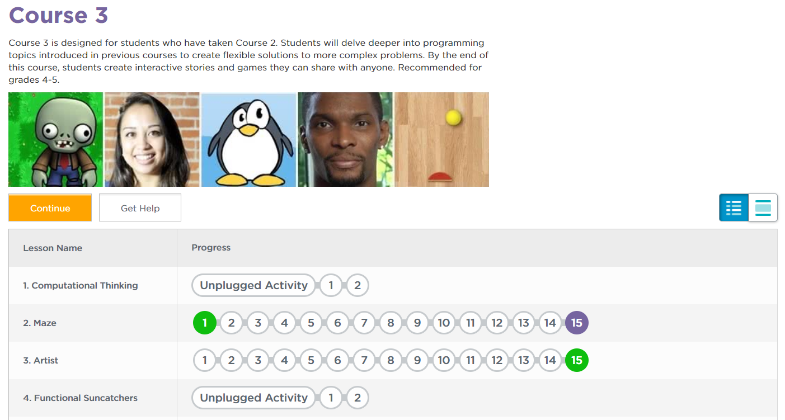
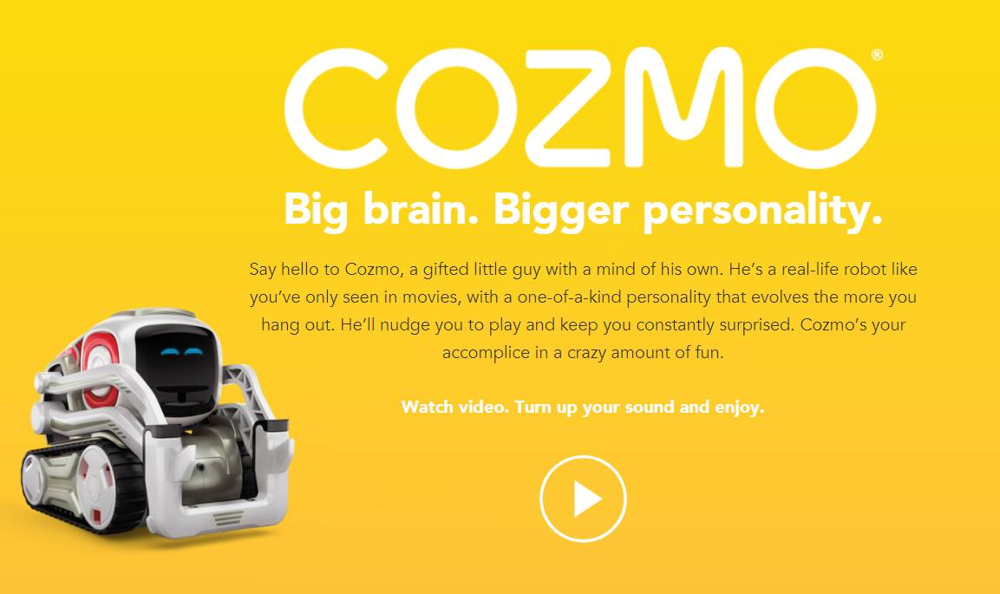
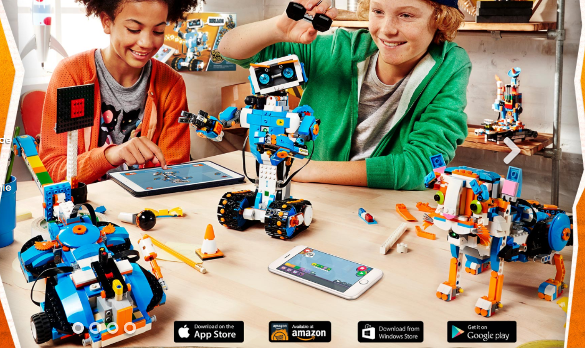

# RoboMaster

-----
Training record for Rex's programing study

----
## 0x01[why]

Rex is going to watch TV with robo combat. and interesting in how to control that. it's a good start point to teach about this. with mathematics & english & logic; 

----
## 0x02[basic]

### [Code.org](https://code.org/)

a very good programing learning site for kids. including resource about PvZ/AngryBird/Minecraft;

### [Cozmo](https://www.anki.com/en-us/cozmo)

best machine learning toy;

### [Lego Boost](https://www.lego.com/en-us/boost)

with othter lego bricks this is also a good machine learning toy;

----
## 0x03[steps]

### [Cozmo Lesson.1](https://github.com/bluefalconjun/RoboMaster/blob/master/Lessons/Maze.md)

----
## 0x04[program info]

### [Imperative programming](https://github.com/bluefalconjun/RoboMaster/blob/master/Info/ImperativeProgram.md)

### [Declarative programming](https://github.com/bluefalconjun/RoboMaster/blob/master/Info/DeclarativeProgram.md)
### [DeepSeek的回答](https://github.com/bluefalconjun/RoboMaster/blob/master/Info/%E5%91%BD%E4%BB%A4%E5%BC%8F%E7%BC%96%E7%A8%8B%E5%92%8C%E5%A3%B0%E6%98%8E%E5%BC%8F%E7%BC%96%E7%A8%8B.pdf)

----
## 0x05[青少年科技比赛信息](https://github.com/bluefalconjun/RoboMaster/blob/master/Info/Competition.md)

-----
with [MIT License](https://github.com/bluefalconjun/RoboMaster/blob/master/LICENSE)
